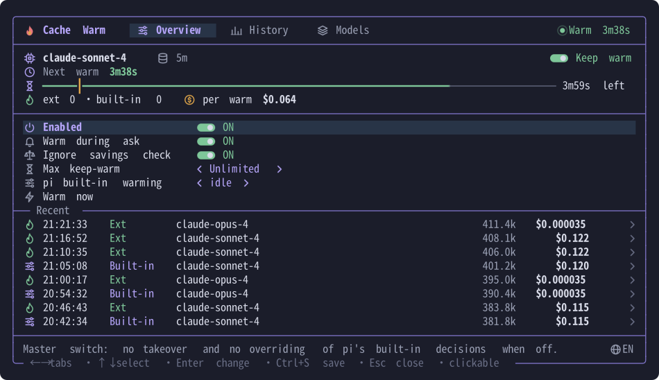
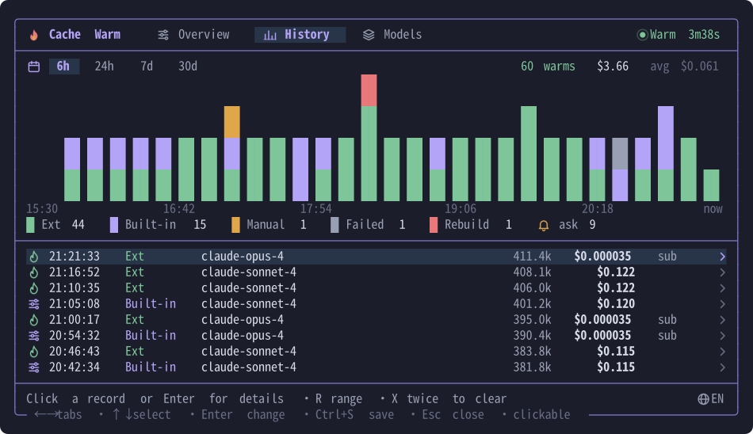
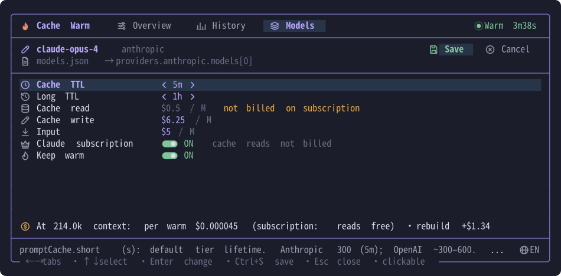

<p align="center">
  <a href="README.md"></a>
  <a href="README.zh-CN.md"></a>
</p>

# pi-cache-warm

Keeps [pi](https://pi.dev)'s prompt cache warm beyond its built-in limits, with a bilingual TUI.



## Features

- **Keep warm** – overrides pi's built-in warming decisions and takes over when it stops (Anthropic Messages, OpenAI Responses / Chat Completions).
- **Ask-aware** – keeps warming while an rpiv `ask_user_question` dialog waits for you; tagged `ask` in history.
- **History** – every warm, rebuild and stop with its cost, as a chart and a list; click a record for details.
- **Model settings** – edit pi's `promptCache` and prices in `models.json`; per-model Claude subscription switch (cache reads not billed).
- **TUI** – English / 中文, plain-text Unicode icons that work in any terminal, mouse and keyboard.




## Install & use

```bash
pi install git:github.com/dibin666/pi-cache-warm
```

`/cachewarm` opens the panel: `←→` tabs · `↑↓` select · `Enter` change · `Ctrl+S` save · `Esc` close.
In fullscreen mode (pi's default) you can also click the `cache warm · next …` status in the footer.
