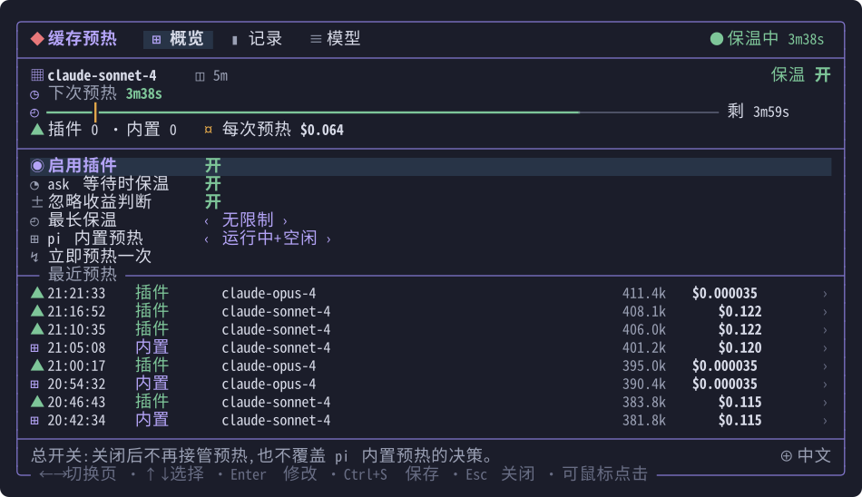
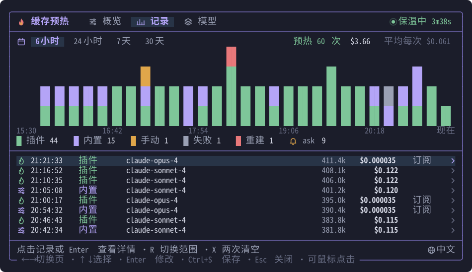
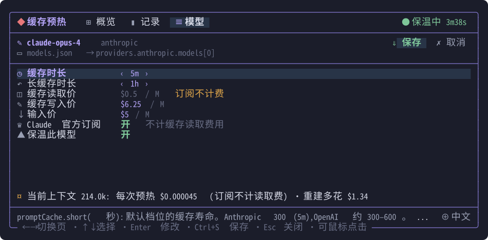

<p align="center">
  <a href="README.md"></a>
  <a href="README.zh-CN.md"></a>
</p>

# pi-cache-warm

让 [pi](https://pi.dev) 的提示缓存突破内置上限持续保温,附中英双语 TUI。



## 功能

- **持续保温**:覆盖 pi 内置预热的决策,内置预热停止后由插件接管(Anthropic Messages、OpenAI Responses / Chat Completions)。
- **ask 联动**:rpiv `ask_user_question` 问答窗口等待回复时持续保温,记录中标记 `ask`。
- **预热记录**:每次预热、重建、停止及其费用,图表加列表,点击记录查看详情。
- **模型设置**:编辑 `models.json` 中的 `promptCache` 与价格;按模型开启 Claude 官方订阅(不计缓存读取费)。
- **TUI**:中文 / English,Unicode 字符图标(任何终端都能显示),支持鼠标与键盘。




## 安装与使用

```bash
pi install git:github.com/dibin666/pi-cache-warm
```

`/cachewarm` 打开面板:`←→` 切换页 · `↑↓` 选择 · `Enter` 修改 · `Ctrl+S` 保存 · `Esc` 关闭。
全屏模式(pi 默认)下也可以直接点击底栏的「缓存保温 · 下次 …」打开。
